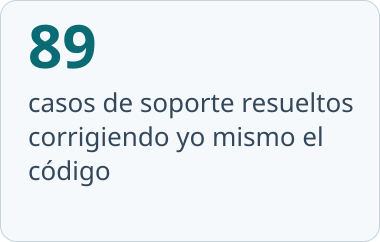

<a href="README.md">English version</a>

<picture><source media="(prefers-color-scheme: dark)" srcset="assets/hero-es-dark.svg"></picture>

**Encuentro la falla, la corrijo en el código y lo demuestro con datos.**

Busco un rol de QA Automation / SDET en Bucaramanga, híbrido o remoto. Disponible de inmediato.

<a href="https://arturdev98.github.io/?lang=es"><picture><source media="(prefers-color-scheme: dark)" srcset="assets/btn-sitio-es-dark.svg"></picture></a>
<a href="https://arturdev98.github.io/cv/?lang=es"><picture><source media="(prefers-color-scheme: dark)" srcset="assets/btn-cv-dark.svg"></picture></a>
<a href="https://www.linkedin.com/in/arturo-isaza-qa"><picture><source media="(prefers-color-scheme: dark)" srcset="assets/btn-linkedin-dark.svg"></picture></a>

<picture><source media="(prefers-color-scheme: dark)" srcset="assets/proof-1-es-dark.svg"></picture><picture><source media="(prefers-color-scheme: dark)" srcset="assets/proof-2-es-dark.svg"></picture><picture><source media="(prefers-color-scheme: dark)" srcset="assets/proof-3-es-dark.svg"></picture>

## Proyectos

### ai-automatization

Un requisito entra y sale como plan de pruebas, pruebas de Playwright, reporte y matriz de trazabilidad. Cuatro agentes de Claude Code (Extractor, Planner, Automator, Reporter), cada uno con el modelo que le toca; nada se automatiza hasta que una persona aprueba el plan.

4 requisitos · 27 criterios · 19 bugs documentados · CI en cada cambio

[Panel en vivo](https://arturdev98.github.io/ai-automatization/) · [Repositorio](https://github.com/ArturDev98/ai-automatization)

- **[helpdesk-triage-agent](https://github.com/ArturDev98/helpdesk-triage-agent)**: Agente de triage para mesas de ayuda: clasifica tickets con Claude, reconoce problemas conocidos y apunta a la causa probable en el código. Es la versión pública, reconstruida desde cero con datos ficticios; tiene modo demo sin API (`python -m triage --dry-run`).
- **[restful-booker-api-tests](https://github.com/ArturDev98/restful-booker-api-tests)**: Pruebas de la API pública restful-booker con pytest + requests + jsonschema: exploración, plan de 30 casos, 16 hallazgos documentados con su severidad y una página del flujo. [Página del flujo](https://arturdev98.github.io/restful-booker-api-tests/)
- **[Chat Privacy Shield](https://github.com/ArturDev98/Chat-Privacy-Shield)**: Extensión de Chrome que difumina chats, nombres y fotos en WhatsApp Web y Telegram Web; disponible en 6 idiomas. [Chrome Web Store](https://chromewebstore.google.com/detail/chat-privacy-shield/gillcdhclnchpkbifcnipfckmapodjpm)

## Más proyectos

| Proyecto | Qué hace | Stack |
|---|---|---|
| [FollowApp](https://chromewebstore.google.com/detail/nffhilcgedjjoednagidnimjnembkdho) | Extensión que avisa quién te dejó de seguir en Instagram y distingue una cuenta suspendida de alguien que se fue. | TypeScript · Chrome MV3 |
| [Best CV](https://best-cv-neon.vercel.app) | Web que reescribe un CV con IA sin inventar datos: si a un logro le falta información, pregunta. | Next.js · Claude API (código privado) |
| [git-team-insights](https://github.com/ArturDev98/git-team-insights) | Ranking de calidad del código por desarrollador con git: bugs rastreados con SZZ y calidad del código propio. | Python · git |
| [ci-image-notifier](https://github.com/ArturDev98/ci-image-notifier) | Bot que avisa en Google Chat o Slack qué imágenes Docker publicó cada build de Jenkins. | Java 21 · Spring Boot · Jenkins |
| [elastic-explorer](https://github.com/ArturDev98/elastic-explorer) | Consulta de solo lectura de Elasticsearch por ambiente, con mappings en árbol y usuarios por cluster. | Spring Boot · Spring Security · Angular |
| [merged_app](https://github.com/ArturDev98/merged_app) | Merged: actividad de GitLab, merge requests y revisiones pendientes en el móvil. | Flutter · OAuth (PKCE) · CI |
| [wash-app-demo](https://arturdev98.github.io/wash-app-demo/) | Demo navegable de un mapa de lavaderos con aviso por WhatsApp (código privado). | React · Leaflet |

## Experiencia

- **HexaSolutions** · Analista de Pruebas QA · may 2023 – nov 2026
- **Avances Software** · Analista de Pruebas QA · ago 2022 – may 2023
- **Sistemas y Computadores S.A.** · QA Tester · jul 2021 – ago 2022

Ingeniería de Sistemas, CUN, en curso · esperado mayo 2027

## Herramientas

**Automatización:** Playwright · Selenium · Katalon Studio · Cucumber  
**API, carga y seguridad:** Postman · SOAP UI · JMeter · LoadRunner · OWASP ZAP · Nessus  
**Código:** Java 11 · Spring Boot · TypeScript · Angular · Ionic · Capacitor · Python · SQL Server · Elasticsearch  
**CI/CD:** Jenkins · GitLab CI · GitHub Actions · Docker · Git  
**IA aplicada:** Claude Code (agentes, skills, MCP) · Claude API  
**Gestión:** Jira · Azure DevOps · Mantis · SysAid · Taiga · Scrum  

## ¿Buscas QA Automation o SDET?

Busco un rol de QA Automation / SDET en Bucaramanga, híbrido o remoto. Disponible de inmediato.

[Escríbeme](mailto:testpbr9@gmail.com) · [LinkedIn](https://www.linkedin.com/in/arturo-isaza-qa) · [arturdev98.github.io](https://arturdev98.github.io/?lang=es)
