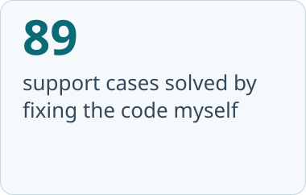
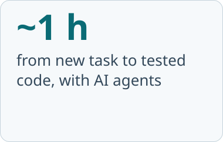

<a href="README.es.md">Versión en español</a>

<picture><source media="(prefers-color-scheme: dark)" srcset="assets/hero-dark.svg"></picture>

Looking for a QA Automation / SDET role, remote or hybrid (based in Bucaramanga, Colombia). Available immediately.

<a href="https://arturdev98.github.io/?lang=en"><picture><source media="(prefers-color-scheme: dark)" srcset="assets/btn-sitio-dark.svg"></picture></a>
<a href="https://arturdev98.github.io/cv/?lang=en"><picture><source media="(prefers-color-scheme: dark)" srcset="assets/btn-cv-dark.svg"></picture></a>
<a href="https://www.linkedin.com/in/arturo-isaza-qa"><picture><source media="(prefers-color-scheme: dark)" srcset="assets/btn-linkedin-dark.svg"></picture></a>

<picture><source media="(prefers-color-scheme: dark)" srcset="assets/proof-1-dark.svg"></picture><picture><source media="(prefers-color-scheme: dark)" srcset="assets/proof-2-dark.svg"></picture><picture><source media="(prefers-color-scheme: dark)" srcset="assets/proof-3-dark.svg"></picture>

## Projects

### ai-automatization

A requirement goes in and comes out as a test plan, Playwright tests, a report and a traceability matrix. Four Claude Code agents (Extractor, Planner, Automator, Reporter), each with the model it needs; nothing is automated until a person approves the plan.

4 requirements · 27 criteria · 19 documented bugs · CI on every change

[Live dashboard](https://arturdev98.github.io/ai-automatization/) · [Repository](https://github.com/ArturDev98/ai-automatization)

- **[helpdesk-triage-agent](https://github.com/ArturDev98/helpdesk-triage-agent)**: Triage agent for help desks: it classifies tickets with Claude, recognizes known problems and points to the probable cause in the code. This is the public version, rebuilt from scratch with fictional data; it has a no-API demo mode (`python -m triage --dry-run`).
- **[restful-booker-api-tests](https://github.com/ArturDev98/restful-booker-api-tests)**: Tests for the public restful-booker API with pytest + requests + jsonschema: exploration, a 30-case plan, 16 documented findings with their severity and a page showing the flow. [Flow page](https://arturdev98.github.io/restful-booker-api-tests/)
- **[Chat Privacy Shield](https://github.com/ArturDev98/Chat-Privacy-Shield)**: Chrome extension that blurs chats, names and photos on WhatsApp Web and Telegram Web; available in 6 languages. [Chrome Web Store](https://chromewebstore.google.com/detail/chat-privacy-shield/gillcdhclnchpkbifcnipfckmapodjpm)

## More projects

| Project | What it does | Stack |
|---|---|---|
| [FollowApp](https://chromewebstore.google.com/detail/nffhilcgedjjoednagidnimjnembkdho) | Extension that tells you who unfollowed you on Instagram and tells a suspended account apart from someone who left. | TypeScript · Chrome MV3 |
| [Best CV](https://best-cv-neon.vercel.app) | Web app that rewrites a CV with AI without making anything up: if an achievement lacks detail, it asks. | Next.js · Claude API (private code) |
| [git-team-insights](https://github.com/ArturDev98/git-team-insights) | Code-quality ranking per developer using git: bugs traced with SZZ and quality of one's own code. | Python · git |
| [ci-image-notifier](https://github.com/ArturDev98/ci-image-notifier) | Bot that tells you in Google Chat or Slack which Docker images each Jenkins build published. | Java 21 · Spring Boot · Jenkins |
| [elastic-explorer](https://github.com/ArturDev98/elastic-explorer) | Read-only Elasticsearch queries per environment, with mappings as a tree and users per cluster. | Spring Boot · Spring Security · Angular |
| [merged_app](https://github.com/ArturDev98/merged_app) | Merged: GitLab activity, merge requests and pending reviews on your phone. | Flutter · OAuth (PKCE) · CI |
| [wash-app-demo](https://arturdev98.github.io/wash-app-demo/) | Browsable demo of a car-wash map with WhatsApp notifications (private code). | React · Leaflet |

## Experience

- **HexaSolutions** · QA Analyst for Crezcamos, a microcredit fintech · May 2023 – Nov 2026
- **Avances Software** · QA Analyst · Aug 2022 – May 2023
- **Sistemas y Computadores S.A.** · QA Tester · Jul 2021 – Aug 2022

B.Eng. Systems Engineering, CUN, in progress · expected May 2027

## Tools

**Test automation:** Playwright · Selenium · Katalon Studio · Cucumber  
**API, load and security:** Postman · SOAP UI · JMeter · LoadRunner · OWASP ZAP · Nessus  
**Code:** Java 11 · Spring Boot · TypeScript · Angular · Ionic · Capacitor · Python · SQL Server · Elasticsearch  
**CI/CD:** Jenkins · GitLab CI · GitHub Actions · Docker · Git  
**Applied AI:** Claude Code (agents, skills, MCP) · Claude API  
**Tracking:** Jira · Azure DevOps · Mantis · SysAid · Taiga · Scrum  

## Hiring for QA Automation or SDET?

[Email me](mailto:testpbr9@gmail.com) · [LinkedIn](https://www.linkedin.com/in/arturo-isaza-qa) · [arturdev98.github.io](https://arturdev98.github.io/?lang=en)
